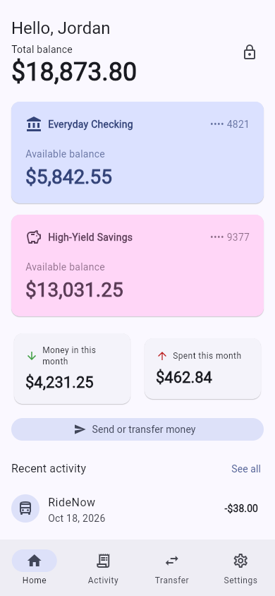
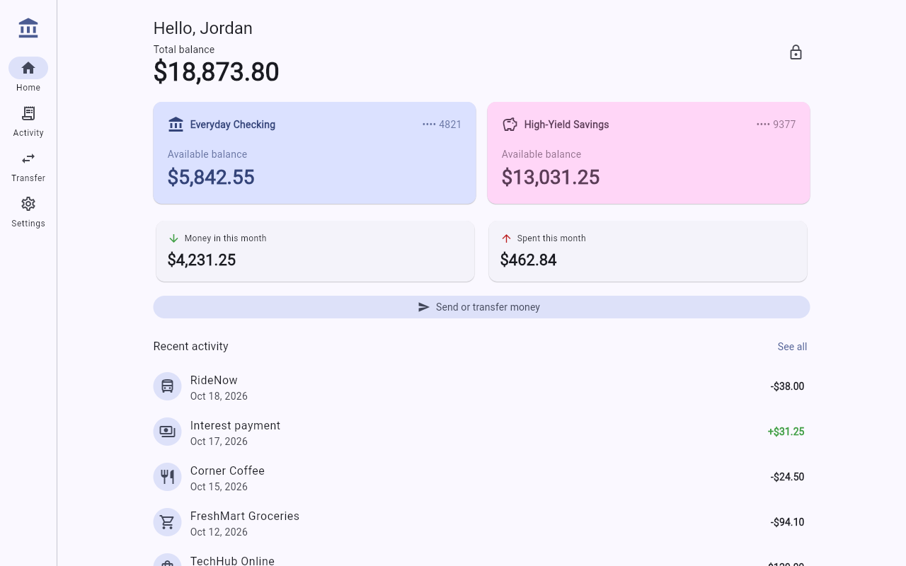

# Horizon Bank (Flutter)

A banking app built with Flutter from **one Dart codebase** that runs on
**Android, iOS, web, Windows, macOS and Linux**. None of the code is written
for one platform only. The layout adapts to the screen size: phones get a bottom
navigation bar, and tablets, desktop windows and browsers get a side rail with
wider layouts.

| Phone | Desktop / web |
|---|---|
|  |  |

## Features

- **Onboarding and PIN lock**: create a profile with a 4–6 digit PIN (stored
  only as a salted SHA-256 hash). After 5 wrong PINs the app locks for 30 seconds.
  You can change the PIN, and "Forgot PIN" erases the device's data.
- **Dashboard**: total balance, account cards, money in and spent this month,
  and recent activity.
- **Activity**: every transaction, with search, a per-account filter and an
  in/out filter. Tap a transaction for its details.
- **Transfers**: move money between your own accounts or pay a saved payee, with
  a confirmation step. Overdrafts, zero amounts and same-account transfers are
  blocked.
- **Payees**: add and remove recipients.
- **Settings**: light, dark or system theme.
- Data is saved on the device, so it survives restarts on every platform.

New profiles start with two demo accounts and sample history so there is
something to explore.

## Run it

Install Flutter (stable channel, 3.47 or newer): https://docs.flutter.dev/get-started/install

```bash
cd banking_app
flutter pub get

flutter run -d chrome     # web
flutter run -d android    # Android device/emulator
flutter run -d ios        # iOS simulator/device (needs macOS + Xcode)
flutter run -d macos      # macOS desktop
flutter run -d windows    # Windows desktop
flutter run -d linux      # Linux desktop
```

Release builds:

```bash
flutter build apk        # or: flutter build appbundle
flutter build ipa        # needs macOS + Xcode
flutter build web
flutter build macos | windows | linux
```

Each platform's build still needs that platform's own toolchain: Xcode for
iOS/macOS, Android SDK for Android, Visual Studio for Windows, and GTK
development headers for Linux. The app code is the same everywhere.

## Tests

```bash
flutter analyze
flutter test
```

The tests cover the banking rules (balances, transfers, overdraft protection,
PIN lockout, persistence, money parsing). They also run the full app in both a
phone-sized and a desktop-sized window.

## Project structure

```
lib/
  main.dart                  App entry, theme, chooses setup/lock/home screen
  models/                    Account, BankTransaction, Payee, BankData (JSON)
  services/
    bank_repository.dart     Storage interface + on-device implementation
    demo_data.dart           Seed accounts and history
  state/
    bank_controller.dart     All banking rules and auth (ChangeNotifier)
    settings_controller.dart Theme preference
  screens/                   Setup, Lock, Home shell, Dashboard, Activity,
                             Transfer, Settings, transaction details
  widgets/common.dart        Shared widgets + responsive layout helpers
  utils/money.dart           Cents formatting and exact amount parsing
```

Money is always stored as whole **cents** (`int`) and parsed from text without
using floating point, so amounts never pick up rounding errors.

## Going to production

This is a working app that keeps its data on the device. It is **not connected
to a real bank**. Before handling real money you would need to:

1. **Connect a backend.** Add a class that implements `BankRepository` (for
   example `ApiBankRepository`) to call your core-banking or open-banking API.
   Then pass it to `BankController` in `main.dart`. No screens need to change.
   Balances and transfers must be decided by the server, never by the client.
2. **Use real authentication**, such as OAuth/OIDC with your identity provider
   and token refresh, in place of a PIN that only exists on the device.
3. **Store secrets securely**, for example with `flutter_secure_storage`
   (Keychain/Keystore). Add biometrics with `local_auth` if you want them.
4. Add certificate pinning, jailbreak/root detection, an automatic
   inactivity lock and audit logging, according to your compliance needs
   (PCI DSS, PSD2/SCA, local regulations).
