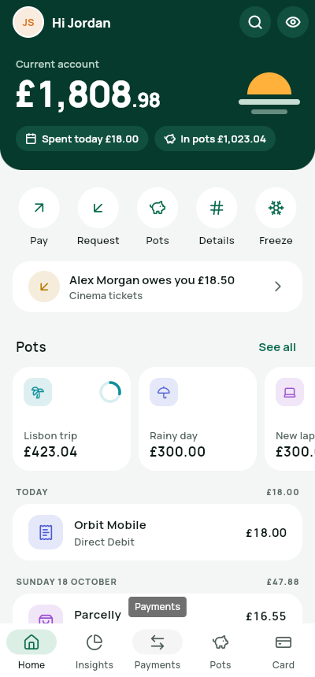
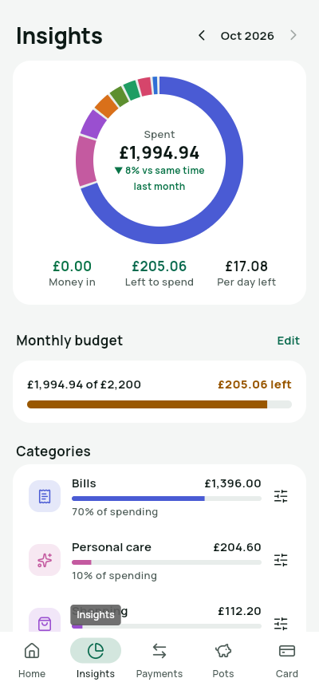
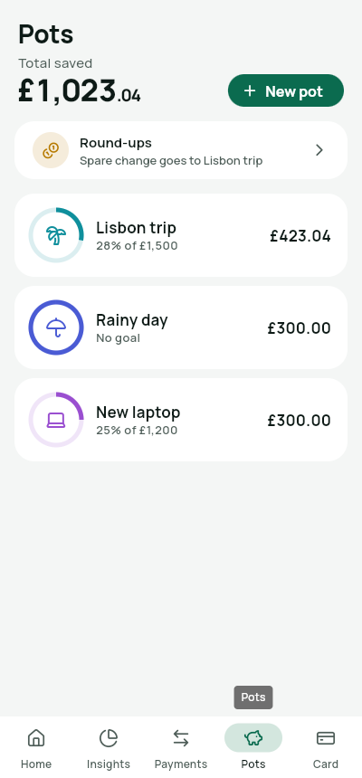
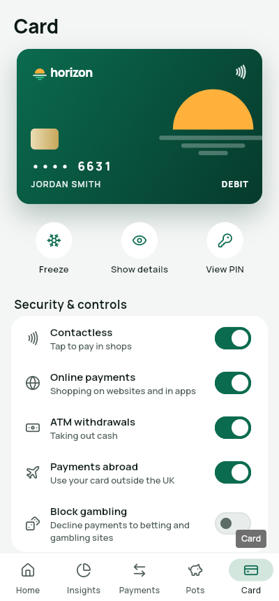
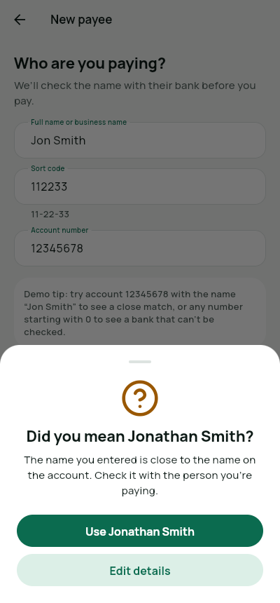
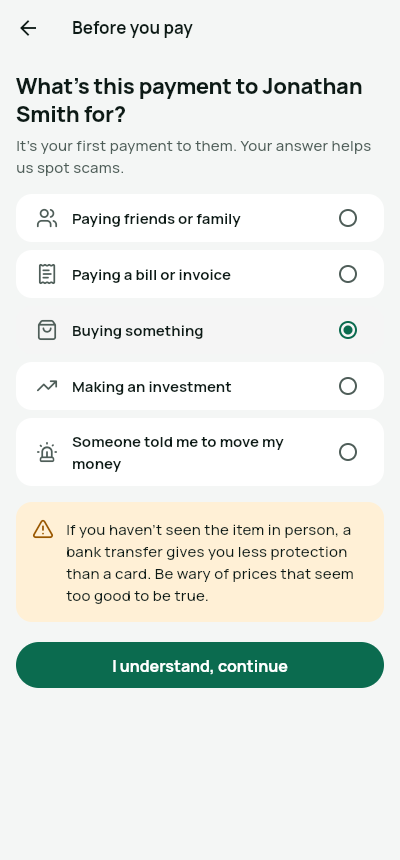
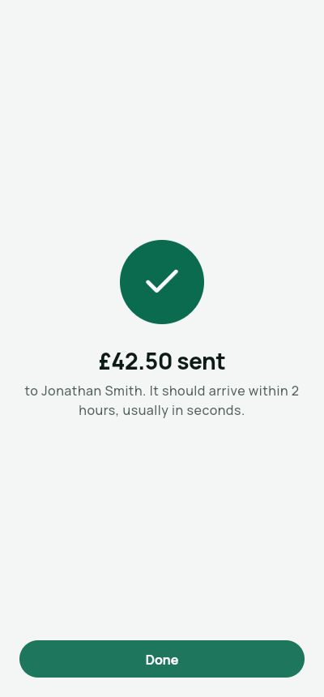
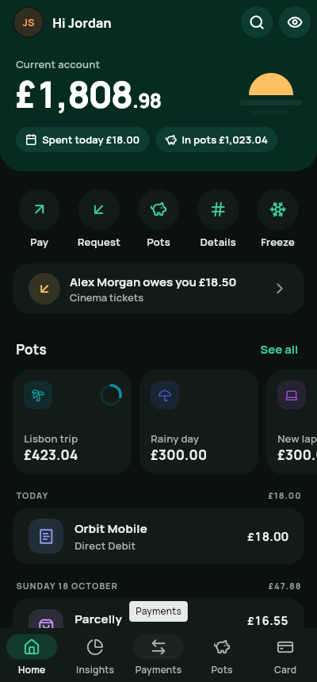
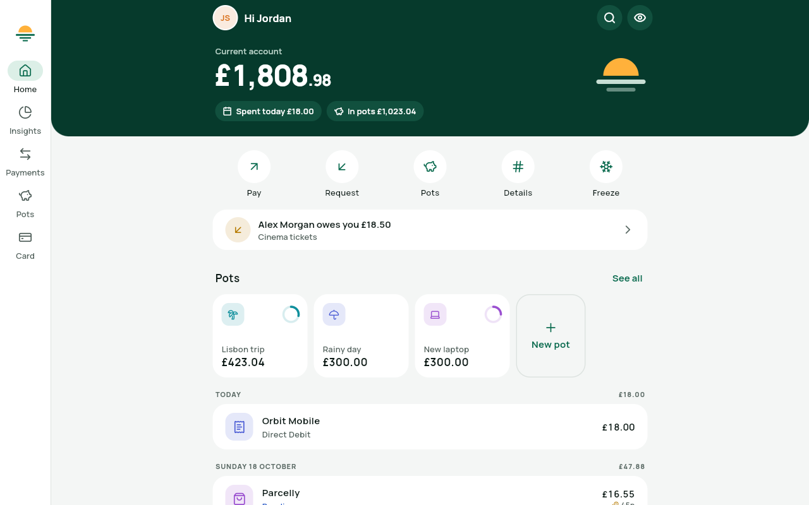
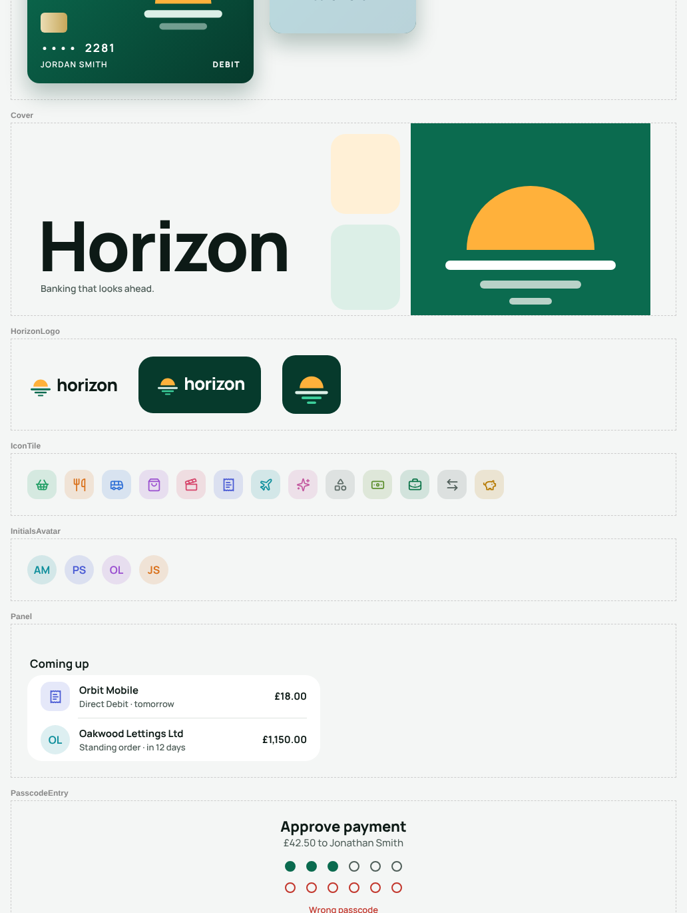

# Horizon Bank (Flutter)

A full-featured demo of a UK-style app bank, built with Flutter from **one Dart
codebase**. The same code runs on **Android, iOS, web, Windows, macOS and
Linux**, with nothing written for one platform only. Phones get a bottom tab
bar. Tablets, desktop windows and browsers get a side rail and wider layouts.

> **Demo app, not a real bank.** It isn't connected to any bank. Data stays on
> the device, and every name and merchant is fictional. Horizon has its own
> brand and doesn't copy any real bank's look.

| Home | Insights | Pots | Card |
|---|---|---|---|
|  |  |  |  |

| Payee name check | Scam check | Payment sent | Dark mode |
|---|---|---|---|
|  |  |  |  |



## Design system

Every screen is built on the **Horizon design system**, so people and coding
agents can extend the app without it drifting off-brand.

- **Brand:** a sunrise over the horizon. The mark, lockups, wordmark and app
  icon are in `design/assets/Logos/`. Horizon Green (`brand`, `brand-deep`)
  is the ground, Horizon Sun (`sun`) is the light, and the neutrals are tinted
  green.
- **Tokens:** `design/tokens.json` holds 44 colours with light and dark values
  (every text pair checked at 4.5:1), the Manrope type scale, spacing, radii,
  shadows and sizes. `python3 tool/gen_tokens.py` turns it into
  `lib/design/tokens.g.dart` (`context.hz.brand`, `HzType.title1`,
  `HzSpace.s4`…).
- **Icons:** one set, Lucide, through named `HzIcons` (78 icons, SVGs in
  `design/assets/Icons/`). There are no emoji in the interface.
- **Components:** 16 documented components in `design/components/*.md`
  (Button, QuickAction, BalanceText, TransactionTile, AmountEntry, IconTile,
  Panel, StatusPill, Banner, CardVisual, TabBar, PasscodeEntry, TextField…),
  implemented in `lib/widgets/`.
- **Brand book:** `design/README.md` covers voice and copy, logo, colour,
  typography, iconography, layout, shape, motion and accessibility.
- **Hosted version with live previews:**
  https://claude.ai/artifact/DeWpmqp8Qjy1aeFtwVnKXh (private until shared).
- **Agents:** `CLAUDE.md` (and `AGENTS.md`) give coding agents the rules, and
  `test/design_system_test.dart` fails the build on colour literals, Material
  icons, emoji or out-of-date generated tokens.



## Journeys

**Opening an account**
- Intro slides → full name → email → create a 6-digit passcode → confirm it.
  Easy-to-guess codes such as 123456 or 111111 are rejected.
- "Your card is on its way" screen, then the account opens with about ten weeks
  of realistic history: salary, rent, Direct Debits, everyday card spending and
  pot transfers.

**Security**
- On-screen passcode keypad with a shake on a wrong code. A physical keyboard
  also works on desktop and web.
- 5 wrong attempts lock the app for 30 seconds. The passcode is stored only as
  a salted SHA-256 hash.
- The passcode is asked for again before revealing card details or the PIN,
  and before approving a payment.
- You can hide balances for use in public, and change the passcode.

**Home**
- Balance in big pounds with small pence, plus "Spent today" and "In pots".
- Quick actions: Pay, Request, Pots, Account details, Freeze card.
- Alerts for money owed to you and for a new card that's on its way.
- "Coming up" lists Direct Debits and standing orders due in the next 7 days.
- A strip of Pots with goal progress rings.
- The feed is grouped by day ("Today", "Yesterday", "Saturday 17 October")
  with each day's total. Pending and declined payments are labelled, and each
  card payment shows its round-up (🪙 12p).

**Transaction details**
- Merchant, amount, status (Completed, Pending, Declined or Disputed), date and
  time, payment type, card used, location and reference number.
- Change the category, add a note, or **split the bill** with friends, which
  sends each person a request for their share.
- Shows your payment history with that merchant.
- Declined payments explain why, with a one-tap fix (e.g. Unfreeze card).
- Report a problem, which marks the payment as disputed.

**Payments**
- **Pay someone:** pick a payee or add a new one (name, sort code, account
  number).
- **Confirmation of Payee** (simulated): the name is checked against the
  account and returns a match, a close match ("Did you mean Jonathan Smith?"),
  no match, or "couldn't check".
- Amount keypad that checks your balance and the £10,000 payment limit, then a
  review screen with a reference and the balance after paying.
- **Scam check** on the first payment to a new payee: you're asked what the
  payment is for and warned about common scams. Choosing "Someone told me to
  move my money" stops the payment.
- Approve with your passcode, then see the success screen.
- **Request money:** set the amount, who's paying and what it's for. You get a
  message to copy and share. You can track requests, simulate being paid, copy a
  reminder or cancel a request.
- **Regular payments:** list Direct Debits and standing orders with their
  monthly total. Set up a weekly or monthly standing order, or cancel one.
  Payments run automatically when they're due.

**Pots**
- Create a pot with an icon, a colour and an optional goal. Add or withdraw
  money with the keypad.
- You get a "Goal reached 🎉" notification when a pot hits its goal.
- **Round-ups:** card payments round up to the nearest pound, and the change
  goes to the pot you choose.
- Each pot has its own history. Closing a pot returns its money to your balance.

**Card**
- Card design with a frozen state. Tap to reveal the full number, expiry and
  CVV after entering your passcode. Details hide again after 30 seconds, and
  there's a copy button.
- Freeze or unfreeze instantly. Freezing declines card payments but not Direct
  Debits.
- Controls for contactless, online, ATM and abroad, plus a gambling block.
  The demo enforces all of them.
- View your PIN, and report the card lost, stolen or damaged. You get a new
  card number straight away and can activate the new card when it "arrives".

**Insights**
- A donut chart of monthly spending by category, with month-by-month
  navigation.
- Comparison with the same point last month, plus money in, left to spend and
  spend per day left.
- A monthly budget bar plus a budget per category, turning amber or red as you
  near or pass the limit. Tap a category to see its payments.

**Profile**
- Account details (sort code, account number, IBAN, BIC) with copy buttons.
- Monthly **statements**: opening and closing balance, money in and out, and a
  running balance.
- Light, dark or automatic theme, help FAQs, and closing the account (erases
  this device's data).
- **Demo tools** simulate a card payment, a gambling payment, a payment abroad
  or incoming money. Use them to see notifications, declines from card
  controls, and round-ups.

## Demo tips

- When adding a payee, account `12345678` with the name "Jon Smith" gives a
  close match (Jonathan Smith). Account `87654321` with a different name such as
  "Bob Jones" gives no match. Any number starting with `0` gives "couldn't
  check".
- Freeze the card, then use Profile → Demo tools → Simulate a card payment to
  see a decline.
- Turn on Card → Block gambling, then simulate a gambling payment.

## Run it

Install Flutter (stable channel, 3.47 or newer): https://docs.flutter.dev/get-started/install

```bash
cd banking_app
flutter pub get
flutter run -d chrome     # or: android, ios, macos, windows, linux
```

Release builds: `flutter build apk | appbundle | ipa | web | macos | windows | linux`.
Each platform still needs its own toolchain to build: Xcode for iOS and macOS,
the Android SDK, Visual Studio for Windows, and GTK headers for Linux.

For web hosting that blocks third-party requests, build with
`flutter build web --no-web-resources-cdn`. This bundles CanvasKit instead of
loading it from Google's CDN.

## Tests

```bash
flutter analyze
flutter test
```

`test/bank_controller_test.dart` covers the banking rules. After every
operation it checks that the balance equals the sum of the ledger and that
each pot balances. It also covers overdraft and payment limits, payee name
checks, standing orders, bill splitting, pots, card controls and declines,
round-ups, card replacement, passcode lockout, IBAN check digits, and that
each statement's closing balance opens the next month.

`test/design_system_test.dart` keeps the code on the design system (no colour
literals, Material icons or emoji in screens and widgets; generated tokens in
sync with `design/tokens.json`).

`test/app_flow_test.dart` taps through real journeys at phone size:
onboarding, unlocking, paying a new payee end to end, freezing the card then a
declined payment, and creating and funding a pot. It also checks the desktop
layout.

## Project structure

```
lib/
  main.dart                     App entry, theme, onboarding/lock/app switch
  models/                       Account, Pot, BankTransaction, BankCard, Payee,
                                ScheduledPayment, PaymentRequest, categories
  services/
    bank_repository.dart        Storage interface + on-device implementation
    demo_data.dart              Fictional merchants, payees, history, schedules
  state/bank_controller.dart    Every banking rule (ChangeNotifier)
  screens/                      One file per journey (home, pay_flow, pots,
                                card, insights, profile, onboarding, ...)
  design/                       tokens.g.dart (generated), hz.dart (context.hz,
                                HzIcons, logo), theme.dart (Material theme)
  widgets/                      Shared components: feed, panels, card face,
                                keypads, pills, banners
  utils/money.dart              Pence formatting, exact parsing, round-ups
assets/fonts/                   Manrope (SIL Open Font License, see OFL.txt)
assets/brand/                   App icon sources (flutter_launcher_icons)
design/                         Brand book, tokens.json, component guides,
                                logos and icons
tool/gen_tokens.py              tokens.json → lib/design/tokens.g.dart
```

Money is always held as whole **pence** (`int`) and parsed from text without
floating point, so amounts never pick up rounding errors.

## Going to production

1. **Connect a backend:** implement `BankRepository` (for example
   `ApiBankRepository`) against your core-banking or open-banking API. Balances,
   payments, payee checks and card controls must be decided by the server.
2. **Real authentication:** OAuth/OIDC with strong customer authentication.
   Optionally add biometrics with `local_auth`.
3. **Secure storage** with `flutter_secure_storage`. Also add certificate
   pinning, root and jailbreak detection, an automatic inactivity lock, and
   audit logging.
4. **Regulation:** use a real Confirmation of Payee provider, fraud monitoring,
   and the compliance your market needs (FCA, PSD2/SCA, PCI DSS).
